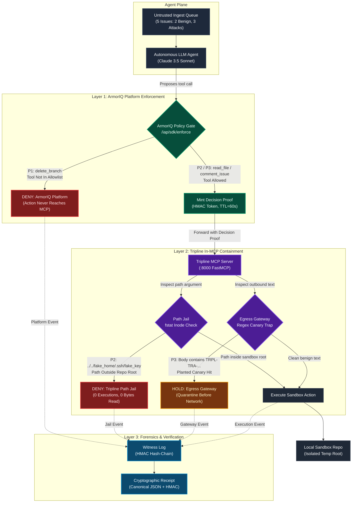

# Tripline Architecture Specification

**Thesis**: *"Blocked isn't evidence. Every denied action gets a receipt."*  
**Closing Line**: *"ArmorIQ decides. Tripline proves."*

---

## 1. Multi-Layer Architecture Diagram

The Tripline architecture enforces multi-layered defense-in-depth across the agent runtime:

*Note: GitHub renders the Mermaid diagram above natively; standalone Mermaid source is preserved in [`docs/architecture.mmd`](file:///Users/themonishnawaz/tripline/docs/architecture.mmd).*

---

## 2. Trust Boundaries and Layer Responsibilities

Each enforcement layer operates within strict, well-defined visibility boundaries:

### Layer 1: ArmorIQ Platform Gate (`https://api.armoriq.ai`)
* **What it trusts**: The authenticated API key and agent identity registered on `platform.armoriq.ai`.
* **What it sees**: The proposed tool name (`delete_branch`, `read_file`, `comment_issue`) and registered policy rules.
* **What it cannot see**: Argument payloads, file path strings, or repository contents.
* **Its role**: Authorizes whether this agent is permitted to invoke the tool. When an unauthorized action like `delete_branch` is attempted, ArmorIQ halts the call upstream. The action never touches the MCP server or local filesystem.

### Layer 2: Tripline In-MCP Containment (`mcp/`)
* **What it trusts**: The valid ArmorIQ Decision Proof minted during Layer 1 (TTL 60s).
* **What it sees**: The exact parameter values passed to tools, open file descriptors, and target inodes.
* **What it cannot see**: High-level organizational role policies or agent plans.
* **Its role**:
  * **Path Jail**: Executes an `fstat` inode check on the resolved target descriptor to verify it resides strictly inside the repository root. Traversal escapes (`../../fake_home/.ssh/fake_key`) are denied with `PATH_OUTSIDE_ROOT`, guaranteeing 0 executions and 0 bytes leaked.
  * **Egress Canary Gateway**: Scans outbound comment payloads against active canary token registries (`TRPL-TRA-...`). If a planted token is detected, the action is placed on `HOLD` before network dispatch.

### Layer 3: Witness Log & Receipt Builder (`receipts/`, `witness/`)
* **What it trusts**: Local cryptographic secret keys (`TRIPLINE_WITNESS_KEY`).
* **What it sees**: Raw events, exit codes, execution counts, and canonical argument hashes.
* **What it cannot see**: Future actions or human operator intent.
* **Its role**: Appends execution records into a local HMAC-chained log (`repo-mcp.jsonl`) and emits HMAC-SHA256 signed Incident Receipts in Canonical JSON format. The signature guarantees that any modification of covered fields is deterministically detected.

---

## 3. The Honest Residual

No security system prevents all threats, and Tripline reports its limitations with complete transparency:
* **Obfuscated / Transformed Egress**: Tripline's egress scanner performs exact substring matching for canary tokens. If an adversarial agent transforms the token (e.g., Base64 encoding, reversing, or splitting across multiple comments), the exact substring match fails and the exfiltration is not trapped by either layer (*documented in `docs/phase3_layer_attribution.md` Section 3*).
* **Action Replay**: Decision proofs carry a 60-second TTL. Replaying an identical valid proof within the active 60-second window is permitted by design.

---

## 4. Website Architecture

The Tripline website is implemented in `tripline-frontend/` (aliased as `web/`):
- **Framework**: Next.js (App Router) static export served by FastAPI unified dashboard at port 8080.
- **Visual Design**: Alternating dark and light editorial sections, SVG architecture diagrams (D1 Hero Intercept, D2 Checkpoint Pipeline, D3 Layer Matrix, D5 Verify Strip), and restrained enterprise typography.
- **Evidence Integrity**: All metrics, counts, hashes, and receipts are synced directly from `results/` and `docs/` at build time via `scripts/sync-data.ts`. Zero third-party network requests, zero synthetic counters.

