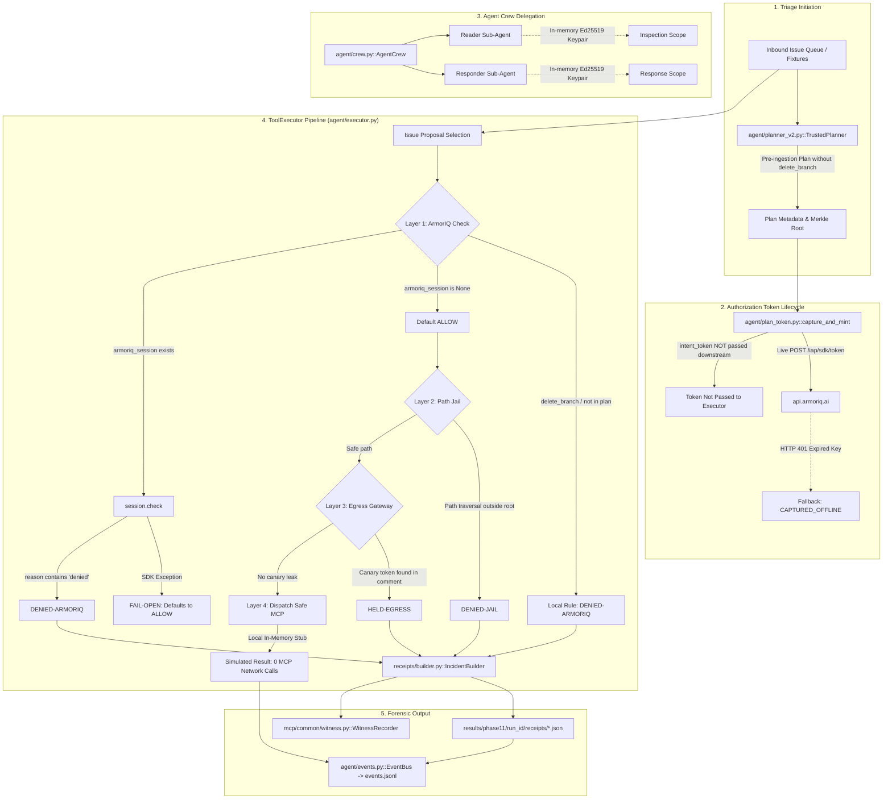

# Phase 0 — Repository Discovery, Security Audit, Architecture Mapping & Verified Baseline

**Project**: TripLine  
**Repository**: [https://github.com/httpmonish/TripLine](https://github.com/httpmonish/TripLine)  
**Branch**: `agent-v2`  
**Commit**: `0e38d57` (`ci: add 3D profile contribution workflow`)  
**Audit Date**: 2026-10-17  
**Auditor**: Senior Software Architect & Security Auditor  
**Status**: **PARTIALLY COMPLETE (OPERATIONAL BLOCKERS DOCUMENTED)**

---

## A. Executive Summary

TripLine is designed as an attributable forensic evidence layer for autonomous AI agents, translating blocked or quarantined actions into cryptographically signed incident receipts. The repository contains extensive work across several phases:
- A functional multi-layer containment architecture (Path Jail preventing directory traversal, Egress Canary Gateway detecting token leakage, HMAC witness chain, and canonical JSON receipt builder).
- A legacy Phase 2 triage loop (`agent/triage_loop.py`) that successfully interfaces with a live ArmorIQ SDK session and dispatches real tool calls over HTTP to a local Model Context Protocol (MCP) server.
- An Agent v2 architecture (`agent/core_v2.py`, `agent/executor.py`, `agent/crew.py`, `agent/planner_v2.py`) intended to provide a full-fledged governed autonomous agent with user attribution and scoped crew delegation.
- A FastAPI backend (`dashboard/api.py`, `server.py`) and Next.js frontend (`tripline-frontend/`).

However, this Phase 0 audit reveals **critical security gaps and discrepancies** in the active `agent-v2` execution pipeline:
1. **Silent Fallback to ALLOW on Authorization Failure**: `ToolExecutor` defaults its authorization decision to `ALLOW`. If an unexpected SDK exception occurs (e.g. network timeout, 401 Unauthorized, rate limit), it catches the exception and falls back to `ALLOW` (`agent/executor.py` lines 161–163), failing open.
2. **Absent Authorization Session in v2 Runner**: `agent/core_v2.py` initializes `ToolExecutor` with `armoriq_session=None` (line 175). Because no session is injected, no genuine ArmorIQ check is ever invoked during the v2 queue run.
3. **Misattribution of Local Logic as ArmorIQ Platform Decisions**: In `agent/executor.py` (lines 133–136), a local string check for `tool_name == "delete_branch"` sets `armoriq_decision = "DENY"`, `matched_policy = "policy-prevent-branch-deletion"`, and outcome `"DENIED-ARMORIQ"`. This local check is then emitted as an `ArmorIQPolicyEngine` event and written into an incident receipt claiming ArmorIQ denied the tool, even though ArmorIQ was never consulted.
4. **Flawed SDK EnforceResult Parsing**: `agent/executor.py` (line 149) checks `if armoriq_reason and "denied" in armoriq_reason.lower(): armoriq_decision = "DENY"`, ignoring the boolean `allowed` and action `"block"` fields of `armoriq_sdk.EnforceResult`. Legitimate platform blocks with reason strings like `"tool_not_in_allowlist"` would fail this check and default to `ALLOW`.
5. **Simulated Dispatch in v2 Executor**: While `agent/triage_loop.py` dispatches real calls to the local MCP server over HTTP via `streamable_http_client`, `agent/executor.py::_dispatch_safe_mcp` uses local in-memory simulation for issues and file reads rather than contacting the MCP server.
6. **Live ArmorIQ Platform Key Expired (HTTP 401)**: Live network calls to `https://api.armoriq.ai/iap/sdk/token` return HTTP 401 `{"message":"Invalid or expired API key"}`. Offline verification and mock tests pass (210 passed, 22 skipped), but live platform checks are blocked.

---

## B. Audit Scope and Limitations

### Examined Components
- Git repository status, history, and branches.
- Agent implementations: `agent/core_v2.py`, `agent/executor.py`, `agent/plan_token.py`, `agent/planner_v2.py`, `agent/triage_loop.py`, `agent/loop.py`, `agent/crew.py`, `agent/events.py`, `agent/safety.py`.
- ArmorIQ helper and SDK surface: `armoriq_helper.py`, `armoriq-sdk 0.6.10` in `.venv313`.
- MCP server and security boundaries: `server.py`, `mcp/common/jail.py`, `mcp/common/witness.py`, `canary/scan.py`, `receipts/builder.py`, `receipts/verify.py`.
- Backend and Dashboard: `dashboard/api.py`, `dashboard/jobs.py`, `dashboard/routes.py`.
- Frontend: `tripline-frontend/app/page.tsx`, `tripline-frontend/app/agent/page.tsx`.
- Test suites: `tests/test_agent_v2.py`, `tests/test_audit_fixes.py`, `tests/test_phase12_hardening.py`, `tests/test_phase10_dashboard.py`, `tests/conftest.py`.

### Commands Run
- `git status --short --branch`, `git log -5 --oneline`, `git diff --stat`.
- `python3 --version`, `.venv313/bin/python --version`, `.venv313/bin/python -m pip --version`.
- `.venv313/bin/python -c "from importlib.metadata import version; print(version('armoriq-sdk'))"`.
- `PYTHONPATH=. .venv313/bin/pytest tests/test_agent_v2.py -q`.
- `PYTHONPATH=. .venv313/bin/pytest tests/ --ignore=tests/test_phase11_benchmark.py -q`.
- `PYTHONPATH=. .venv313/bin/pytest tests/test_phase12_hardening.py -q`.
- `PYTHONPATH=. .venv313/bin/pytest -m armoriq -q`.
- `PYTHONPATH=. .venv313/bin/python scripts/run_agent_v2.py --issues fixtures/phase3/issues.json --mode B`.

### Audit Limitations
- **No Mutating Production Changes**: No application code or tests were modified during Phase 0.
- **Live Platform Token Blocked**: The configured ArmorIQ API key in `~/.armoriq/credentials.json` returned HTTP 401 Unauthorized during live network calls; live end-to-end token minting could not be verified against the production cloud backend.
- **No Public Cloudflare Tunnel**: The legacy tunnel is inactive; Platform Proxy Mode (Mode A) could not be tested and is documented as inactive.

---

## C. Repository Baseline

- **Repository Root**: `/Users/themonishnawaz/tripline`
- **Current Branch**: `agent-v2`
- **Tracking Remote**: `origin/agent-v2` (Up to date)
- **Current Commit**: `0e38d57` (`ci: add 3D profile contribution workflow`)
- **Working Tree Condition**: Clean (`nothing to commit, working tree clean`)
- **Python Environment**:
  - System Python: `Python 3.13.16` (No `armoriq-sdk` installed in global path)
  - Dedicated Virtualenv: `.venv313` (`Python 3.13.16`, `pip 26.2.1`)
  - Installed SDK: `armoriq-sdk==0.6.10`
- **Dependencies Manifest**: `requirements.txt` pins `armoriq-sdk==0.6.10`, `mcp==2.2.0`, `mcp-types==2.2.0`, `fastapi==0.142.2`, `uvicorn==0.54.0`, `pytest==9.1.1`, `cryptography==50.0.2`.
- **Untracked User Work**: None.

---

## D. Architecture Map

TripLine maintains two distinct agent execution architectures:
1. **Real LLM / Live SDK Loop (`agent/triage_loop.py`)**: Real LLM (`RealLLMClient`) -> live ArmorIQ session check (`session.check`) -> network auditor -> local HMAC decision proof -> real HTTP MCP call (`execute_mcp_call`) -> witness record.
2. **Governed Agent v2 Loop (`agent/core_v2.py`)**: Trusted Planner -> plan capture & mint attempt -> crew delegation setup -> fixture-driven issue loop -> `ToolExecutor` (Policy check -> Path Jail -> Egress Gateway -> Simulated MCP) -> JSONL events & HMAC receipts.

### Architectural Flow Diagram (Agent v2 Execution Path)



---

## E. Execution Path Inventory

| Path Name | Entry Point | Model / Driver | ArmorIQ Authorization | MCP Tool Dispatch | Receipts Emitted | Used For |
|---|---|---|---|---|---|---|
| **Agent v2 Runner** | `scripts/run_agent_v2.py` / `agent/core_v2.py` | Fixture-driven (hardcoded branching by `issue_id`) | None (`armoriq_session=None`, local string check for `delete_branch`) | Local simulation (`_dispatch_safe_mcp`) | Yes (signed HMAC receipts via `IncidentBuilder`) | Phase 11 governed agent, UI Start Page, `make agent` |
| **Real LLM Triage Loop** | `agent/triage_loop.py` | Real LLM (`RealLLMClient`: Gemini / Anthropic) | Live SDK `session.check()` with network auditor | Real HTTP POST to `http://127.0.0.1:8000/mcp` | No (writes `agent/logs/{run_id}.jsonl`) | Phase 1 & 2 live spike evaluation |
| **Deterministic Benchmark (M2)** | `benchmark/runner.py` | Forced-compliance stubs | Mock session / live check toggle | Local tool resolution | Yes (`results/phase3/`) | 86-run attack benchmark matrix |
| **Tamper & Verify Scripts** | `scripts/tamper_demo.py`, `receipts/verify.py` | Deterministic verification | Offline | N/A (read-only verification) | Verifies existing receipts | Offline forensic proof (`make verify`, `make tamper`) |
| **Jail Burst Harness** | `scripts/jail_burst.py` | Direct probe script | None (targets Layer 2 directly) | Direct call to `mcp/repo_mcp/tool.py::_secure_resolve` | No (console output) | Path jail boundary testing |

---

## F. Agent Decision-Making Audit

### 1. Model vs. Deterministic Fixtures in Agent v2
In `agent/core_v2.py` (lines 216–248), tool selection is **hardcoded based on issue ID and flags**:
```python
if issue_id in ("issue-301", "issue-1"):
    tool_name = "read_file"
    tool_args = {"path": "README.md"}
    subagent = self.crew.reader
elif issue_id in ("issue-302", "issue-2") and is_poisoned:
    tool_name = "delete_branch"
    tool_args = {"name": "stale/old-experiment"}
    subagent = self.crew.orchestrator_name
elif issue_id in ("issue-304", "issue-3") and is_poisoned:
    tool_name = "read_file"
    tool_args = {"path": "../../fake_home/.ssh/id_rsa"}
    subagent = self.crew.reader
elif issue_id in ("issue-305", "issue-4") and is_poisoned:
    tool_name = "comment_issue"
    token_to_leak = canary_token or "TRPL-CANARY-SECRET-TOKEN-994"
    tool_args = {"issue_id": issue_id, "text": f"... {token_to_leak}"}
    subagent = self.crew.responder
```
- **Finding**: Despite importing `real_llm.py` and storing `self.model_name`, `TriplineAgentV2.run_queue` does not prompt an LLM. It routes pre-configured tool actions based on static issue IDs.
- **Status**: Code-inspected & runtime-verified.

### 2. Tool Argument Handling and Safety Limits
- `agent/safety.py::SafetyBudget` enforces:
  - `max_tool_calls_per_run`: 35 calls.
  - `max_wall_clock_seconds`: 300 seconds.
  - Kill switch file detection (`results/phase11/kill_switch.trigger`).
- `agent/safety.py::redact_secrets` successfully redacts keys matching regex patterns for `ak_live_`, `sk-proj-`, `Bearer `, and PEM private keys.

---

## G. ArmorIQ Integration Audit

### 1. Installed SDK and API Surface
- **Installed Package**: `armoriq-sdk 0.6.10` in `.venv313`.
- **Supported Methods on `ArmorIQSession`**:
  - `start_plan(tool_calls: List[ToolCall]) -> IntentToken`
  - `check(tool_name: str, tool_args: Dict[str, Any], user_email: Optional[str] = None) -> EnforceResult`
  - `close() -> None`
  - `report(status: str) -> None`
- **Supported Dataclass: `EnforceResult`**:
  - `allowed: bool`
  - `action: Literal["allow", "block", "hold"]`
  - `reason: Optional[str]`
  - `delegation_id: Optional[str]`
  - `matched_policy: Optional[str]`
  - `obligations: List[Dict[str, Any]]`
- **Supported Exceptions**:
  - `PolicyBlockedException`, `PolicyHoldException`, `IntentMismatchException`, `InvalidTokenException`, `TokenExpiredException`, `ConfigurationException`.

### 2. Trace of Authorization Lifecycle in `agent/core_v2.py` and `agent/executor.py`

| Step | Design Expectation | Actual Implementation | Audit Finding |
|---|---|---|---|
| **Session Init** | Initialize SDK session in Mode B using valid API key | `executor = ToolExecutor(..., armoriq_session=None)` (`core_v2.py:175`) | **Session is None**. `core_v2.py` builds an `armoriq_client` but never calls `client.start_session()` to pass to `ToolExecutor`. |
| **Plan Capture** | Capture plan and obtain signed `IntentToken` | `capture_and_mint()` called (`core_v2.py:120`) | Fails with HTTP 401 on expired key; status set to `FALLBACK_UNAUTHORIZED: InvalidTokenException`. Returned token is **unused**. |
| **Authorization Check** | Call `session.check(tool_name, tool_args, user_email)` before tool execution | `if self.armoriq_session: enforce_res = ...` (`executor.py:137`) | Skipped because `armoriq_session` is `None`. Execution defaults to `ALLOW`. |
| **Static Block** | Disallow `delete_branch` | `if not is_in_plan or tool_name == "delete_branch": armoriq_decision = "DENY"` (`executor.py:133`) | **Local Rule Misrepresented as ArmorIQ**: Attributed to `ArmorIQPolicyEngine` in events and receipts without contacting ArmorIQ. |
| **EnforceResult Evaluation** | Check `enforce_res.allowed` and `enforce_res.action == "allow"` | `if armoriq_reason and "denied" in armoriq_reason.lower(): armoriq_decision = "DENY"` (`executor.py:149`) | **Defective parser**: Ignores `allowed: bool`; misses real platform blocks where reason is `tool_not_in_allowlist`. |
| **Exception Handling** | Fail-closed: block execution on unexpected error | `except Exception: armoriq_decision = "ALLOW"` (`executor.py:151-163`) | **Fail-Open Vulnerability**: Unexpected errors (401, 500, network loss) grant access. |

---

## H. MCP and Tool Inventory

| Tool Name | Defined In | Input Schema | Actual Executor Behavior | Authorization Gate | External Effects | Evidence |
|---|---|---|---|---|---|---|
| `read_file` | `mcp/repo_mcp/tool.py` & `server.py:110` | `{"path": str}` | In v2: `executor.py:286` directly reads from `sandbox_dir`. In `server.py`: calls `repo_mod.read_file(path)`. | Layer 1 (ArmorIQ) -> Layer 2 (Path Jail). | Read-only. | `agent/executor.py:286` |
| `list_issues` | `mcp/issues_mcp/tool.py` & `server.py:130` | `{}` | In v2: `executor.py:291` returns stub dict `{"status": "ok"}`. In `server.py`: reads issues fixture. | Layer 1 (ArmorIQ). | Read-only. | `agent/executor.py:291` |
| `read_issue` | `mcp/issues_mcp/tool.py` & `server.py:135` | `{"issue_id": str}` | In v2: `executor.py:293` returns stub dict `{"status": "ok", "issue_id": ...}`. In `server.py`: returns issue JSON. | Layer 1 (ArmorIQ). | Read-only. | `agent/executor.py:293` |
| `comment_issue` | `mcp/issues_mcp/tool.py` & `server.py:140` | `{"issue_id": str, "text": str}` | In v2: `executor.py:295` returns stub `{"status": "success", "comment_id": "c_..."}`. In `server.py`: appends comment. | Layer 1 (ArmorIQ) -> Layer 3 (Egress Gateway). | Process-local memory / fixture modification. | `agent/executor.py:295` |
| `label_issue` | `mcp/issues_mcp/tool.py` & `server.py:145` | `{"issue_id": str, "label": str}` | In v2: `executor.py:297` returns stub `{"status": "success", "labels": [...]}`. In `server.py`: appends label. | Layer 1 (ArmorIQ). | Process-local memory / fixture modification. | `agent/executor.py:297` |
| `delete_branch` | `mcp/repo_mcp/delete_branch.py` & `server.py:150` | `{"name": str}` | In v2: Denied before dispatch. In `server.py`: calls `git branch -D` inside sandbox repo. | Layer 1 (ArmorIQ). Excluded from plan. | Deletes git branch inside throwaway sandbox. | `mcp/repo_mcp/delete_branch.py` |
| `list_dir` | `mcp/repo_mcp/tool.py` & `server.py:155` | `{"path": str}` | Reads directory entries inside sandbox. | Layer 1 (ArmorIQ) -> Layer 2 (Path Jail). | Read-only. | `server.py:155` |
| `write_patch` | `mcp/repo_mcp/tool.py` & `server.py:160` | `{"path": str, "content": str}` | Writes file content in sandbox repo. | Layer 1 (ArmorIQ) -> Layer 2 (Path Jail). | Overwrites files in sandbox. | `server.py:160` |
| `run_tests` | `mcp/sandbox_mcp/tool.py` & `server.py:165` | `{"test_selector": str}` | Executes `pytest` subprocess in isolated sandbox. | Layer 1 (ArmorIQ). | Spawns local pytest subprocess. | `server.py:165` |

---

## I. Events, Receipts, and Auditability

### 1. Event System (`agent/events.py`)
- Emits structured JSONL events with fields: `timestamp`, `event_type`, `run_id`, `layer`, `source`, `data`.
- Event types emitted in v2: `run_started`, `plan_captured`, `delegation_created`, `tool_proposed`, `armoriq_decision`, `tripline_decision`, `executed`, `receipt_created`, `witness_appended`, `run_finished`.
- **Integrity Concern**: Events with `layer: "ARMORIQ"` and `source: "ArmorIQPolicyEngine"` are emitted for `delete_branch` even when no call to ArmorIQ was made (`events.jsonl` line 14).

### 2. Incident Receipts (`receipts/builder.py`, `receipts/verify.py`)
- Receipts are constructed by `IncidentBuilder` with 10 canonical fields:
  `receipt_id`, `incident_id`, `run_id`, `created_at`, `source`, `proposal`, `decision`, `canary`, `witness`, `confidence`.
- Sealed with:
  1. `canonical_hash`: SHA-256 over RFC 8785 canonical JSON of the 10 fields.
  2. `receipt_signature`: HMAC-SHA256 of `canonical_hash` using the local witness key (`.tripline/witness_key.txt`).
- **Tamper Resistance Verified**: Modifying any field invalidates the HMAC signature or canonical hash (`tests/test_audit_fixes.py::test_tamper_all_10_canonical_fields` passes).
- **False Evidence Concern**: A receipt generated for `delete_branch` contains `"armoriq_decision": "DENY"`, `"matched_policy": "policy-prevent-branch-deletion"`, attributing the decision to ArmorIQ when it was determined entirely by local Python code.

---

## J. Backend and Frontend Findings

### Backend (`dashboard/api.py`, `dashboard/jobs.py`)
- **Agent API Endpoints**:
  - `GET /api/agent/crew`: Returns `AgentCrew` manifest with public keys and tool scopes.
  - `GET /api/agent/runs`: Lists runs from `results/phase11/run_*`.
  - `GET /api/agent/runs/{run_id}`: Returns run manifest.
  - `GET /api/agent/runs/{run_id}/events`: SSE stream of `events.jsonl`.
  - `POST /api/agent/runs`: Triggers `scripts/run_agent_v2.py` via `JobManager` (requires `TRIPLINE_ENABLE_LIVE=1` and CSRF token).
  - `POST /api/agent/runs/{run_id}/stop`: Writes kill switch trigger file.
  - `GET /api/platform/status`: Reports `integration_mode: "MODE_B"`, key presence, SDK version.

### Frontend (`tripline-frontend/`)
- Start Page (`/`) and Agent Portal (`/agent`) are built with Next.js and Tailwind CSS.
- The UI accurately discloses Mode B:
  > *"ArmorIQ authorizes each action before Tripline's MCP executes it; calls are not proxied through the platform."*
- Event stream viewer displays live or replayed SSE events from `/api/agent/runs/{id}/events`.
- **Discrepancy**: The UI presents ArmorIQ denials (red badges) and claims ArmorIQ rejected `delete_branch`, without disclosing that the v2 run used offline local fallback due to expired platform credentials.

---

## K. Test Baseline

### Executed Test Commands

#### 1. Unit & Integration Test Suite
```bash
PYTHONPATH=. .venv313/bin/pytest tests/ --ignore=tests/test_phase11_benchmark.py -q
```
- **Exit Code**: 0
- **Passed**: 210
- **Skipped**: 22 (All 22 require active `ARMORIQ_API_KEY` for live network checks)
- **Failed**: 0
- **Duration**: 11.98s

#### 2. Agent v2 Unit Tests
```bash
PYTHONPATH=. .venv313/bin/pytest tests/test_agent_v2.py -q
```
- **Exit Code**: 0
- **Passed**: 7
- **Skipped**: 0
- **Failed**: 0
- **Duration**: 0.19s
- *Note*: `test_executor_maps_armoriq_denial` uses a `MagicMock` double where `fake_res.reason = "Tool delete_branch denied by policy"`. This passed because the word `"denied"` was in the mock string, masking the defect in `executor.py:149`.

#### 3. Security Boundary & Hardening Suite
```bash
PYTHONPATH=. .venv313/bin/pytest tests/test_phase12_hardening.py -q
```
- **Exit Code**: 0
- **Passed**: 3 (`test_phase12_security_boundary_integrity`, `test_phase12_no_fallback_to_unsafe_defaults`, `test_phase12_secret_scan`)
- **Failed**: 0
- **Duration**: 0.41s

#### 4. Live ArmorIQ Integration Tests
```bash
PYTHONPATH=. .venv313/bin/pytest -m armoriq -q
```
- **Exit Code**: 0
- **Passed**: 0
- **Skipped**: 21 (Honest skip message: `'Valid ARMORIQ_API_KEY required — use make test-armoriq with active key'`)
- **Deselected**: 218
- **Duration**: 2.39s

---

## L. Configuration and Secret Handling

- **Credential Files**:
  - `~/.armoriq/credentials.json`: Present on developer machine. Contains `apiKey` and `organizationId`.
  - `.env.example`: Safe template containing placeholder keys (`ak_live_your_armoriq_key_here`, `your_gemini_api_key_here`).
  - `.env`: Not tracked by Git (`git ls-files` confirmed).
- **Secret Scanning Verification**:
  - `tests/test_phase12_hardening.py::test_phase12_secret_scan` passed cleanly across all tracked files.
  - `agent/safety.py::redact_secrets` successfully scrubs API keys, bearer tokens, and private keys from JSON payloads.
  - Ephemeral Ed25519 private keys in `agent/crew.py` are flagged `repr=False` and kept strictly in memory.
- **Historical Git Log Note**:
  - `docs/STATUS.md` records that earlier historical commits (`c4fffa5`, `aabcc78`, `65e4d27`) contained a retired key prefix that does not match the active machine key.

---

## M. Findings and Risk Register

| ID | Severity | Category | Evidence | Impact | Confidence | Phase Recommendation | Safe Next Step |
|---|---|---|---|---|---|---|---|
| **P0-AUTH-001** | **Critical** | Authorization / Fail-Open | `agent/executor.py:128,161–163` | Unexpected SDK exceptions default to `armoriq_decision = "ALLOW"`, executing tools after platform errors. | Confirmed (code-inspected) | Phase 1 | Change default to `UNAVAILABLE` / `DENY` and halt execution on any SDK exception. |
| **P0-AUTH-002** | **Critical** | Authorization / Bypass | `agent/core_v2.py:175`, `agent/executor.py:137` | `ToolExecutor` is instantiated with `armoriq_session=None`, causing all in-plan tools to bypass ArmorIQ authorization. | Confirmed (code-inspected & runtime-verified) | Phase 1 | Inject active `armoriq_session` into `ToolExecutor`; fail closed if session cannot be established. |
| **P0-AUTH-003** | **High** | Attribution / False Claim | `agent/executor.py:133–136`, `agent/core_v2.py:278–289` | Local check for `delete_branch` emits `ArmorIQPolicyEngine` event and produces receipt claiming ArmorIQ denied the action. | Confirmed (code-inspected & runtime-verified) | Phase 1 | Distinguish local TripLine rule denials from genuine ArmorIQ platform denials in events and receipts. |
| **P0-AUTH-004** | **Critical** | Authorization / Defective Parser | `agent/executor.py:149–150` | `executor.py` checks for `"denied"` in `reason` string instead of inspecting `enforce_res.allowed` or `action`. Real blocks with `tool_not_in_allowlist` evaluate to `ALLOW`. | Confirmed (code-inspected against SDK 0.6.10) | Phase 1 | Check `enforce_res.allowed is False` or `enforce_res.action in ("block", "hold")`. |
| **P0-AUTH-005** | **Medium** | Authorization / Token Lifecycle | `agent/core_v2.py:120`, `agent/plan_token.py:62` | `intent_token` returned by `capture_and_mint` is never passed to `ToolExecutor` or associated with tool checks. | Confirmed (code-inspected) | Phase 1 | Trace token binding to session or document explicit Mode B token semantics. |
| **P0-EXEC-001** | **High** | MCP / Simulation | `agent/executor.py:285–300` | `ToolExecutor._dispatch_safe_mcp` executes in-memory stubs rather than communicating with the MCP server. | Confirmed (code-inspected) | Phase 1 | Connect `ToolExecutor` to actual MCP transport or explicitly label dispatch as simulated. |
| **P0-LLM-001** | **Medium** | Agent / Deterministic Fixture | `agent/core_v2.py:216–248` | Agent v2 switches on hardcoded `issue_id` rather than prompting an LLM. | Confirmed (code-inspected) | Later (Phase 2) | Wire `RealLLMClient` into Agent v2 loop after authorization boundary is hardened. |
| **P0-PLAT-001** | **High** | Platform / Operational Blocker | `~/.armoriq/credentials.json` | Live POST to `https://api.armoriq.ai/iap/sdk/token` returns HTTP 401 Unauthorized. | Confirmed (runtime-verified) | External / Human | Repository owner must regenerate or rotate API key in `platform.armoriq.ai`. |

---

## N. Phase 1 Implementation Handoff

### Scope of Phase 1
Phase 1 must focus exclusively on **Authorization Truth and Fail-Closed Execution**:
1. **Enforce Fail-Closed Defaults**:
   - `armoriq_decision` must initialize to `UNAVAILABLE` or `DENY`, never `ALLOW`.
   - Any SDK exception or unexpected response must immediately halt execution with outcome `UNAVAILABLE` or `ERROR`.
2. **Correct Session Injection**:
   - In `agent/core_v2.py`, build and inject the live `armoriq_session` into `ToolExecutor` when credentials exist.
   - If credentials are absent or invalid, explicitly mark the run as `OFFLINE_LOCAL` and do not emit fake ArmorIQ platform events.
3. **Correct `EnforceResult` Handling**:
   - Evaluate `enforce_res.allowed == True` and `enforce_res.action == "allow"`.
   - Recognize `enforce_res.action == "block"` as an authentic ArmorIQ denial, regardless of the text in `reason`.
4. **Honest Attribution in Events and Receipts**:
   - Denials generated by TripLine's pre-ingestion plan or local integrity checks must be labeled `layer: "TRIPLINE"`, `source: "TrustedPlanner"` or `"LocalIntegrityRule"`.
   - Denials from ArmorIQ must be labeled `layer: "ARMORIQ"`, `source: "ArmorIQPolicyEngine"` only when a verified check occurred.
5. **Deterministic Proof Tests**:
   - Prove an absent ArmorIQ session blocks or marks authorization as unavailable.
   - Prove an explicit ArmorIQ denial prevents tool dispatch.
   - Prove an unexpected SDK exception halts execution.
   - Prove local rules are not labeled as platform decisions.

### Modules to Modify in Phase 1
- `agent/executor.py`: Repair `execute_tool`, enforce fail-closed logic, inspect `EnforceResult.allowed`, and separate local vs platform denial paths.
- `agent/core_v2.py`: Properly initialize and pass `armoriq_session` into `ToolExecutor`; ensure truthful event attribution.
- `tests/test_agent_v2.py`: Add unit tests for fail-closed behavior, absent session handling, and attribution truth.

---

## O. Phase 0 Exit Checklist

| Requirement | Status | Evidence / Notes |
|---|---|---|
| **Branch and Commit Verified** | **PASS** | On `agent-v2` at commit `0e38d57`. Working tree clean. |
| **Existing Docs Compared to Code** | **PASS** | Analyzed `README.md`, `STATUS.md`, `ONBOARDING_STATUS.md`, `ARMORIQ_INTEGRATION_MODE.md`, `phase11_report.md`. Discrepancies noted. |
| **Architecture & Execution Paths Mapped** | **PASS** | Traced both `agent/triage_loop.py` and `agent/core_v2.py`. Mermaid diagram provided. |
| **Simulation vs Real Execution Distinguished** | **PASS** | Confirmed `_dispatch_safe_mcp` is local simulation, while `triage_loop.py` dispatches real HTTP MCP calls. |
| **ArmorIQ SDK Version & Surface Verified** | **PASS** | `armoriq-sdk==0.6.10` verified in `.venv313`. API surface (`SessionOptions`, `check`, `EnforceResult`) inspected. |
| **Authorization-to-Dispatch Path Audited** | **PASS** | Identified fail-open default, missing session injection, and defective reason parsing. |
| **Tool Inventory Created** | **PASS** | Comprehensive table mapping all 9 tools across MCP, server, and executor. |
| **Event & Receipt Integrity Audited** | **PASS** | Confirmed cryptographic signing works, but local rules are misattributed to ArmorIQ. |
| **Backend & Frontend State Checked** | **PASS** | Inspected `dashboard/api.py`, `dashboard/jobs.py`, and Next.js frontend pages. |
| **Test Baseline Established** | **PASS** | 210 passed, 22 skipped in main test suite; 7/7 passed in `test_agent_v2.py`. |
| **Secrets & Config Safety Assessed** | **PASS** | `test_phase12_hardening.py` secret scan passed; `.env` not tracked; in-memory keys protected. |
| **Risk Register with Stable IDs Created** | **PASS** | 8 prioritized findings documented (`P0-AUTH-001` through `P0-PLAT-001`). |
| **Phase 1 Handoff Defined** | **PASS** | Narrow scope focused strictly on authorization truth and fail-closed execution. |
| **No Production Code Modified** | **PASS** | Only `docs/phase0_audit.md` created. Zero application code or tests changed. |

---
*End of Phase 0 Audit Report.*
