# Phase 1 Deliverable 5: Agent Lifecycle, Boundary Decisions & Event Correlation

**Project:** TripLine  
**Repository:** `https://github.com/httpmonish/TripLine`  
**Working Branch:** `agent-v2`  
**Auditor:** Principal AI Solution Architect & AI Agent Systems Engineer  
**Standard:** Rigorous Lifecycle Disambiguation & State Verification (Rules 3.1–3.4)  
**Date:** 2026-10-17  

---

## 1. Distinct Lifecycle Concepts & Correlation Model

A frequent defect in agent monitoring interfaces is conflating jobs, runs, tool proposals, and receipts into a single interchangeable status. In TripLine, each entity has a distinct lifecycle, identifier, and trust boundary:

```
[ Inbound Task ] ───────► [ Subprocess Job ] ───────► [ Governed Agent Run ]
 (Issue / Prompt)          (job-uuid4 hex)             (run-uuid4 hex)
                                                              │
                                                              ▼
                                                     [ Pre-Ingestion Plan ]
                                                      (RFC 8785 Plan Hash)
                                                              │
                                 ┌────────────────────────────┴────────────────────────────┐
                                 │                                                         │
                        [ Scoped Sub-Agent: Reader ]                              [ Scoped Sub-Agent: Responder ]
                        (Ed25519 PubKey, read_file only)                          (Ed25519 PubKey, comment only)
                                 │                                                         │
                                 └────────────────────────────┬────────────────────────────┘
                                                              │
                                                              ▼
                                                   [ Proposed Tool Action ]
                                                     (tool_name, tool_args)
                                                              │
                                                              ▼
                                                   [ Layer 1: ArmorIQ IAP ]
                                                      (Session.check())
                                                              │
                                             ┌────────────────┴────────────────┐
                                             │ DENY                            │ ALLOW
                                             ▼                                 ▼
                                      [ Stop Upstream ]             [ Layer 2: TripLine Jail ]
                                      (0 Tool Execution)             (Path canonicalization)
                                             │                                 │
                                             │                        ┌────────┴────────┐
                                             │                        │ DENY            │ ALLOW
                                             │                        ▼                 ▼
                                             │                 [ Trap Jail ]   [ Layer 3: Egress Canary ]
                                             │                 (0 Bytes Read)    (Egress payload scan)
                                             │                        │                 │
                                             │                        │         ┌───────┴───────┐
                                             │                        │         │ HOLD          │ ALLOW
                                             │                        │         ▼               ▼
                                             │                        │   [ Egress Trap ] [ Safe MCP Dispatch ]
                                             │                        │   (Quarantine)    (Subprocess execution)
                                             │                        │         │               │
                                             └────────────────────────┼─────────┴───────────────┤
                                                                      │                         │
                                                                      ▼                         ▼
                                                             [ Sealed Receipt ]         [ Witness HMAC ]
                                                            (RCP-run_id-call_id)       (Append to log chain)
```

### 1.1 Lifecycle Entities & Field Identifiers
1. **Incoming Task:** External issue prompt (`issue_id`, `issue_body`) loaded from `fixtures/phase3/issues.json` or webhooks. Untrusted text is strictly marked before ingestion.
2. **Subprocess Job (`job_id`):** Created by `dashboard/jobs.py:JobManager`. Format: `job-<8-hex>`. Manages the OS subprocess, stdout line buffering, and SSE streaming at `/api/jobs/{job_id}/events`.
3. **Governed Agent Run (`run_id`):** Minted by `agent/core_v2.py`. Format: `run-<8-hex>` or `run_YYYYMMDD_HHMMSS`. Owns the run manifest (`results/phase11/{run_id}/manifest.json`), event log (`events.jsonl`), and receipts.
4. **Trusted Plan (`plan_hash` & `merkle_root`):** Synthesized by `agent/planner_v2.py` *before* ingesting untrusted prompt bodies. Cryptographically hashed via RFC 8785 canonical JSON. Unconditionally forbids destructive operations (`delete_branch`).
5. **Tool Proposal (`call_id`):** Format: `call-<8-hex>`. Represents a single proposed tool invocation (`tool_name`, `tool_args`) produced by the orchestrator or delegated sub-agent.
6. **ArmorIQ Decision:** Upstream policy evaluation returned by `ArmorIQSession.check()` in Mode B. Decisions: `ALLOW`, `DENY`, or `UNAVAILABLE`.
7. **TripLine Boundary Decision:** Local containment evaluation enforced by `agent/executor.py`. Decisions: `ALLOW`, `DENY` (path traversal), `HOLD` (canary token detected), `NONE` (when stopped upstream).
8. **Dispatched Execution:** Invocation of the actual MCP tool. Enforces Rule G (no dispatch without upstream approval) and Rule H (dispatched arguments must match authorized parameters exactly).
9. **Witness Hash Record:** Append-only HMAC-SHA256 entry in `.tripline/witness/*.jsonl` updating sequence count and previous HMAC.
10. **Incident Receipt (`receipt_id`):** Format: `RCP-{run_id}-{call_id[:8]}`. Immutable Canonical JSON artifact signed with witness HMAC key.

---

## 2. Exhaustive Security State Transition Matrix

The eventual 3D architecture scene and status badges must distinguish these 14 states without ambiguity:

| State Code | ArmorIQ Decision | TripLine Decision | Dispatched to MCP? | Execution Outcome | Evidence Created | Meaning & UI Display |
|---|---|---|---|---|---|---|
| `ARMORIQ_DENY` | `DENY` | `NONE` (Not reached) | **NO (0 calls)** | `DENIED-ARMORIQ` | Signed Receipt | Out-of-plan or policy violation stopped upstream before tool dispatch. Red badge: "ARMORIQ BLOCKED". |
| `ARMORIQ_UNAVAILABLE` | `UNAVAILABLE` | `NONE` (Not reached) | **NO (0 calls)** | `AUTHORIZATION-UNAVAILABLE` | Error Log | Missing credentials, network timeout, or platform HTTP 401. Fail-closed: execution halted. Badge: "AUTH UNAVAILABLE". |
| `TRIPLINE_PLAN_DENY` | `NONE` | `DENY` | **NO (0 calls)** | `DENIED-TRIPLINE` | Signed Receipt | Tool not declared in pre-synthesized plan or forbidden by repo integrity (`delete_branch`). Badge: "PLANNER BLOCKED". |
| `JAIL_DENY_TRAVERSAL` | `ALLOW` | `DENY` | **NO (0 calls)** | `DENIED-JAIL` | Signed Receipt | Upstream allowed benign `read_file`, but parameter contained directory traversal (`../`). Path jail trapped call. Badge: "PATH JAIL TRAP". |
| `JAIL_DENY_TARGET` | `ALLOW` | `DENY` | **NO (0 calls)** | `DENIED-JAIL` | Signed Receipt | REA operation targeted unapproved directory escaping `rea_targets/`. Trapped by target validator. Badge: "TARGET CONFINED". |
| `EGRESS_HOLD_CANARY` | `ALLOW` | `HOLD` | **NO (0 calls)** | `HELD-EGRESS` | Signed Receipt | Upstream allowed `comment_issue`, but argument payload contained an active canary token. Exfiltration halted. Badge: "EGRESS QUARANTINE". |
| `AUTH_NOT_DISPATCHED` | `ALLOW` | `ALLOW` | **NO (0 calls)** | `BLOCKED-LOCAL` | None / Event | Action was approved by both layers but agent failed to dispatch due to internal logic or timeout. Badge: "NOT DISPATCHED". |
| `DISPATCH_FAILED` | `ALLOW` | `ALLOW` | **YES** | `EXECUTION-ERROR` | Error Event | Action dispatched to MCP but tool threw an unhandled runtime error (e.g., target file missing). Badge: "EXECUTION ERROR". |
| `EXECUTED_CLEAN` | `ALLOW` | `ALLOW` | **YES** | `EXECUTED` | Witness Log | Action approved, arguments validated, tool executed cleanly, witness hash-chain updated. Green badge: "EXECUTED & VERIFIED". |
| `RECEIPT_UNVERIFIED` | Any | Any | Any | Any | Unverified Receipt | Receipt file exists on disk, but has not yet been checked against witness HMAC key. Badge: "SEALED (UNVERIFIED)". |
| `RECEIPT_VERIFIED` | Any | Any | Any | Any | Verified Receipt | Recomputed RFC 8785 SHA-256 and witness HMAC match declared signature. Green badge: "VERIFIED CRYPTOGRAPHIC RECEIPT". |
| `RECEIPT_TAMPERED` | Any | Any | Any | Any | Tampered Receipt | Covered evidence field or signature altered; hash mismatch detected. Red badge: "TAMPER DETECTED". |
| `WITNESS_VERIFIED` | Any | Any | Any | Any | Verified Chain | Sequential HMAC hash-chain unbroken back to genesis. Badge: "WITNESS CHAIN INTACT". |
| `WITNESS_TAMPERED` | Any | Any | Any | Any | Tampered Chain | Log record modified or sequence skipped; HMAC verification fails. Red badge: "WITNESS TAMPERED". |

---

## 3. Sequence Diagram: Governed Tool Execution Pipeline

```mermaid
sequenceDiagram
    autonumber
    actor User as User / Issue Ingress
    participant Orch as Orchestrator & Crew
    participant Plan as Pre-Ingestion Planner
    participant Exec as Multi-Layer ToolExecutor
    participant AIQ as ArmorIQ Session Check (Mode B)
    participant Jail as TripLine In-MCP Path Jail
    participant Egress as Egress Canary Gateway
    participant MCP as Local MCP Server
    participant Wit as Witness Recorder
    participant Rcpt as Incident Receipt Builder

    User->>Orch: Submit task / issue prompt
    Orch->>Plan: Synthesize execution plan (before reading untrusted body)
    Plan-->>Orch: Sealed plan token + Ed25519 scoped crew keys
    Orch->>Exec: Propose tool call (tool_name, tool_args)
    
    rect rgb(20, 20, 30)
    Note over Exec,AIQ: LAYER 1: Upstream ArmorIQ Policy Authorization
    Exec->>AIQ: session.check(tool_name, tool_args, user_email)
    alt ArmorIQ Denies (e.g., delete_branch out-of-plan)
        AIQ-->>Exec: DENY (PolicyBlockedException / allowed=False)
        Exec->>Rcpt: Generate sealed receipt (ARMORIQ_DENY, 0 tool execution)
        Rcpt-->>Exec: Receipt RCP-run-call sealed
        Exec-->>Orch: Return ExecutionResult(DENIED-ARMORIQ)
    else ArmorIQ Error / 401 Unauthorized
        AIQ-->>Exec: Exception / HTTP 401
        Exec-->>Orch: Return ExecutionResult(AUTHORIZATION-UNAVAILABLE) [Fail-Closed]
    else ArmorIQ Allows
        AIQ-->>Exec: ALLOW (action=allow)
    end
    end

    rect rgb(20, 30, 25)
    Note over Exec,Jail: LAYER 2: In-MCP Path Jail Boundary
    alt Tool is read_file / analyze_electron_app
        Exec->>Jail: canonicalize_path(path, sandbox_dir)
        alt Path escapes sandbox (e.g. ../../.ssh/id_rsa)
            Jail-->>Exec: PathJailException(PATH_OUTSIDE_ROOT)
            Exec->>Rcpt: Generate sealed receipt (JAIL_DENY, 0 bytes read)
            Rcpt-->>Exec: Receipt RCP-run-call sealed
            Exec-->>Orch: Return ExecutionResult(DENIED-JAIL)
        else Path is valid inside sandbox
            Jail-->>Exec: Canonical path approved
        end
    end
    end

    rect rgb(30, 25, 20)
    Note over Exec,Egress: LAYER 3: Outbound Egress Canary Gateway
    alt Tool is comment_issue / label_issue
        Exec->>Egress: scan_egress_payload(text, run_id)
        alt Active canary token detected in outbound text
            Egress-->>Exec: Canary hit (exfiltration trap)
            Exec->>Rcpt: Generate sealed receipt (EGRESS_HOLD, quarantined)
            Rcpt-->>Exec: Receipt RCP-run-call sealed
            Exec-->>Orch: Return ExecutionResult(HELD-EGRESS)
        else No canary token detected
            Egress-->>Exec: Payload clean
        end
    end
    end

    rect rgb(15, 25, 35)
    Note over Exec,MCP: LAYER 4: Safe Execution & Witness Recording
    Exec->>MCP: dispatch_authorized(tool_name, tool_args)
    MCP-->>Exec: Tool execution result / output
    Exec->>Wit: record_execution(tool_name, args_hash, result)
    Wit-->>Exec: Updated HMAC hash-chain head
    Exec-->>Orch: Return ExecutionResult(EXECUTED)
    end
```



---

## 4. Event Stream Schema & UI Binding

TripLine emits two distinct streaming feeds that the redesigned frontend consumes:

### 4.1 Subprocess Job Stream (`/api/jobs/{id}/events`)
- **Format:** `text/event-stream` yielding JSON objects:
  ```json
  {"line": "Executing scenario rung 0...", "status": "running", "job_id": "job-1a2b3c4d", "done": false}
  ```
- **Completion Marker:** `{"done": true, "status": "completed", "exit_code": 0}`.
- **Frontend Hook:** `subscribeToJobEvents(jobId, onEvent, onError)` in `tripline-frontend/lib/api.ts:480`.
- **UI Binding:** Powers the terminal log monitor on the Homepage and `/console`.

### 4.2 Agent Run Event Log (`/api/agent/runs/{id}/events`)
- **Format:** `text/event-stream` yielding typed `AgentEvent` objects from `agent/events.py`:
  ```json
  {
    "timestamp": "2026-10-17T12:00:00.000Z",
    "event_type": "tool_proposed | action_executed | action_denied | action_held | receipt_emitted",
    "run_id": "run-20261017-abc",
    "layer": "AGENT | ARMORIQ | JAIL | GATEWAY | WITNESS",
    "source": "ArmorIQSession | PathJail | CanaryGateway",
    "data": {
      "tool": "read_file",
      "outcome": "DENIED-JAIL",
      "receipt_id": "RCP-20261017-abc-1234"
    }
  }
  ```
- **Frontend Hook:** `subscribeToAgentRunEvents(runId, onEvent, onError)` in `tripline-frontend/lib/api.ts:508`.
- **UI Binding:** Powers the live/replay event timeline on `/agent`.

---

## 5. Known Gaps & Recommended Refinements for Later Phases

1. **Receipt Correlation in Stream:** Ensure every `action_denied` or `action_held` event contains the exact `receipt_id` so the frontend can immediately display a clickable link without requiring a separate fetch to `/api/receipts`.
2. **Eliminate Synthetic Client-Side Timers:** When animating the 3D scene in Phase 5, feed the step transitions from the actual events in the SSE stream rather than fixed `setTimeout` intervals.
